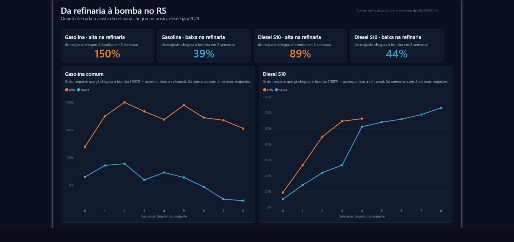
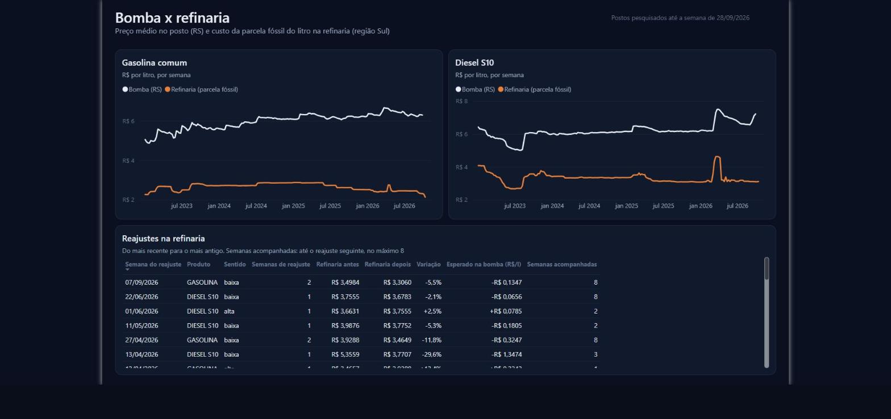
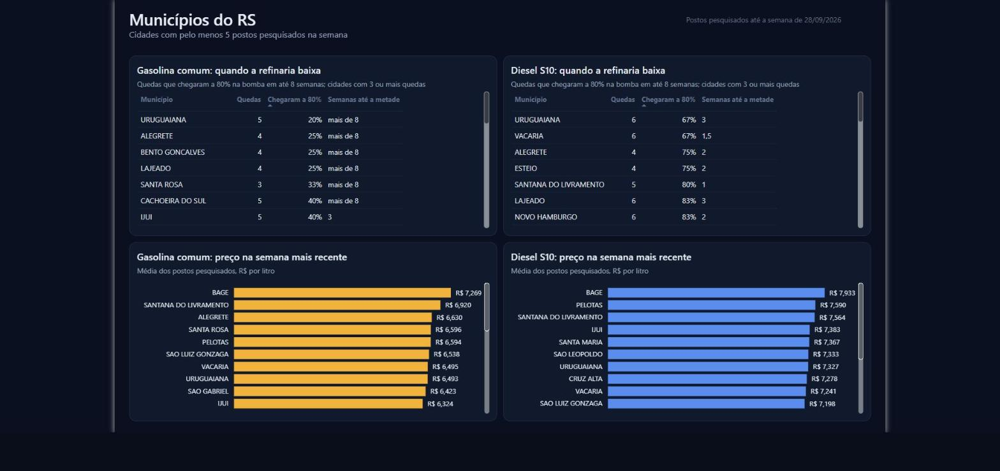

# From refinery to pump in Rio Grande do Sul · Microsoft Fabric + Power BI

[Versão em português](README.md)

When the price of gasoline or diesel changes at the refinery, **how much of it reaches the gas station in Rio Grande do Sul (RS), Brazil, and how fast?** And does it pass through the same way when prices go up as when they go down?

This project answers with public data from ANP, Brazil's oil and fuel regulator: a Microsoft Fabric pipeline fetches every week the price at each surveyed gas station in Brazil and the average price of producers and importers, processes it in layers (lakehouse → warehouse), measures the pass-through of every price change and delivers a Power BI report.



## What the data shows

Since January 2023, the refinery series (South region) had **31 price changes**: 12 for gasoline and 19 for S10 diesel. For each one, I compared the change in the average pump price in RS with what the refinery would explain (change × fossil share of the liter).

| How much of the change reached the pump (RS) | same week | after 1 week | after 2 weeks |
|---|---|---|---|
| Gasoline, refinery **increase** (6 changes) | 69% | 125% | 150% |
| Gasoline, refinery **cut** (6 changes) | 15% | 35% | 39% |
| S10 diesel, refinery **increase** (8 changes) | 18% | 53% | 89% |
| S10 diesel, refinery **cut** (11 changes) | 10% | 28% | 44% |

*Weighted pass-through: sum of pump changes ÷ sum of what the refinery would explain, so each change weighs by its size. Above 100% = the pump rose more than the cost of the fossil product explains.*

- **Rockets and feathers.** For gasoline, increases reach the pump in full within a week; for cuts, less than 40% arrived within two weeks. Diesel shows a smaller but real asymmetry.
- **The 2026 diesel shock** is the clearest case. In March the refinery price rose 50% over three weeks (from R$ 3.64 to R$ 5.45 per liter, average of producers and importers in the South) and S10 diesel in RS went from R$ 6.19 to R$ 7.51: 86% of the expected pass-through in three weeks. In April the refinery price fell back to R$ 3.77; three weeks later, only 27% of the cut had reached the pump. In August, with the refinery back at February levels, diesel in RS still cost R$ 6.59, R$ 0.40 above the pre-shock price.

Each group has few price changes (6 to 11), so the numbers point to a pattern, not a law. The pump price also has other components that change (anhydrous ethanol and biodiesel, freight, margins and ICMS state tax); the analysis measures how much the pump moved relative to what the refinery would explain, it does not prove the cause of the gap.

## Sources

| Source | What it holds | How it is loaded |
|---|---|---|
| [Fuel price historical series](https://www.gov.br/anp/pt-br/centrais-de-conteudo/dados-abertos/serie-historica-de-precos-de-combustiveis) (ANP) | Selling price at each surveyed gas station, by product and collection date | Zipped half-year files since 2023 and, for the current half-year, the monthly files. Only new or resized files are downloaded again |
| [Weekly weighted average prices of producers and importers](https://www.gov.br/anp/pt-br/assuntos/precos-e-defesa-da-concorrencia/precos/ppidp/precos-medios-ponderados-semanais-2013.xls) (ANP) | Weekly average price, without ICMS, of gasoline A and S10 diesel A, by region | One .xls sheet, fully reloaded |

Gasoline sold at the pump is gasoline A blended with anhydrous ethanol (27% until Jul/2025, 30% after), and S10 diesel is diesel A blended with biodiesel (B10 to B15). The blend in force each week lives in a configuration table and sets the fossil share of the liter.

## Architecture


- **Bronze (`nb_01_ingestao`)**: reads ANP's page, discovers the files (monthly file names changed over time) and stores each one as received, with source file and load time. A control table keeps the size and hash of each file; the two most recent are always reprocessed because ANP still corrects them.
- **Silver (T-SQL)**: types dates and values, keeps only liquid fuels sold by the liter and deduplicates (the same station, product and day can come in two files). Invalid records are not dropped: they go to quarantine with the reason (`data_invalida`, `valor_fora_da_faixa`, `unidade_inesperada`…).
- **Gold (T-SQL)**: mean, median and range of prices by week, city and state; refinery price with each week's fossil share; weekly calendar.
- **Analysis (T-SQL)**: event study of the pass-through (below).
- **Model and report**: the semantic model (TMDL, Direct Lake on the Warehouse) and the report (PBIR, 3 pages) are generated by code in `tools/` and published by the installer.
- **Orchestration**: a Data Factory pipeline runs everything every Wednesday at 8 am. ANP updates the refinery sheet about 12 days late.

## How the pass-through is measured

1. **Refinery series**: average price of producers and importers in the South region, **smoothed by a 3-week median**. The sheet mixes refineries and importers, and the mix changes from one week to the next; without smoothing, a one-week spike (gasoline: 3.50 → 4.53 → 3.50 in August 2026) turned into a fake −23% price change.
2. **Price change**: a week in which the smoothed series moves 2% or more. Consecutive weeks in the same direction count as a single change (the 2026 diesel increase came over three weeks).
3. **Expected pass-through** = refinery change × fossil share of the liter. ICMS became a fixed amount per liter in 2023 (diesel in May, gasoline in June), so from then on it does not amplify the pass-through.
4. **Observed pass-through** after h weeks = average pump price in RS at t+h minus the week before the change.
5. Each change is followed for up to 8 weeks, **but only until the next change**, so one change does not contaminate the measurement of another.

The same analysis runs for each city in RS with at least 5 stations surveyed in the week.

## Quality and cross-check

- **Quality rules** (`fabric/sql/05_qualidade.sql`), stored on every run in `qualidade.resultado`: row reconciliation between bronze, silver and quarantine; duplicate keys in silver and gold; refinery weeks without a configured blend in the analyzed period; RS average out of range; missing weeks; stale sources; one-week refinery spikes. A rule with severity `erro` stops the pipeline.
- **Independent cross-check** (`nb_02_conferencia`): recomputes in Python, straight from bronze, the weekly RS average price, the list of price changes and the pass-through curve, and compares them with what the Warehouse produced in T-SQL. If they do not match, the pipeline fails. This cross-check is what confirmed that the new price-change rule gives the same result in both languages.
- **Tests** (`tests/`): reading ANP files (BOM, latin-1, zip, missing columns), discovering files on the page in both naming formats and parsing the refinery sheet.

## Report

| Pump x refinery | Cities |
|---|---|
|  |  |

## How to run

Locally (tests):

```bash
pip install pandas pytest
pytest
```

On Fabric:

1. Create a workspace with capacity (the trial capacity works).
2. Create a notebook and run, pinning the commit you reviewed:
   ```python
   import requests
   COMMIT = "<full-commit-sha>"
   EXECUTAR = True
   exec(requests.get(f"https://raw.githubusercontent.com/GuilhermeRostirolla/precos-combustiveis-fabric/{COMMIT}/tools/instalar_no_fabric.py").text)
   ```
   The installer creates the lakehouse, the warehouse, the notebooks, the SQL objects, the pipeline with its weekly schedule, the semantic model and the report. With `EXECUTAR = True`, it triggers the first load (about 10 minutes).

## Problems along the way

- **Spikes in the refinery sheet.** The producers-and-importers average jumps from week to week when an importer enters or leaves. The first version of the analysis found 65 "price changes", many of them one-week spikes; with the 3-week median and the grouping of consecutive weeks, 31 remained.
- **Too few "isolated" changes.** The first rule only accepted changes with no other change in the next 6 weeks. With frequent changes, that dropped almost all diesel events. Following each change until the next one uses all of them without mixing effects.
- **Blend configured for only part of the history.** The refinery sheet starts in 2013, but the blend table started in 2015 (gasoline) and 2018 (diesel); the quality rule flagged 2,201 weeks without a blend. Since the analysis starts in 2023, the rule now requires a blend only within the analyzed period.
- **Spark session limit on the trial capacity (error 430).** The installer triggers the pipeline and stops its own session; ingestion retries after 2 minutes.
- **Temp tables in the Fabric Warehouse.** Only a temp table created with `SELECT ... INTO` can be combined with warehouse tables in the same query, so the quality rules live in a single `SELECT INTO`.
- **Lagging SQL endpoint.** Right after ingestion, the lakehouse endpoint does not see the new tables yet; the notebook requests a metadata refresh before the Warehouse reads bronze.
- **SQL decimals in Python.** `pyodbc` returns `decimal.Decimal`, which does not mix with `float` in the cross-check math.

## Limitations

- The South-region producers-and-importers price approximates what distributors in RS pay; it mixes refineries and importers.
- ANP's survey is a sample: about 310 gasoline stations per week in RS on average, fewer in small cities.
- The pass-through compares the pump with the fossil share; changes in anhydrous ethanol, biodiesel, freight, margins and ICMS also move the final price and are not separated here. For changes in the first half of 2023, ICMS was still a percentage rate, which slightly increases the expected pass-through.

## Structure

```
src/anp.py                  reading ANP sources (no Spark, testable locally)
fabric/notebooks/           ingestion (bronze) and cross-check
fabric/sql/                 config, silver, gold, pass-through analysis and quality (T-SQL)
fabric/*.SemanticModel/     semantic model (TMDL), generated by tools/gerar_modelo.py
fabric/*.Report/            report (PBIR), generated by tools/gerar_relatorio.py
tools/instalar_no_fabric.py installs and updates everything in the workspace
tests/
```

## License

[MIT](LICENSE)
