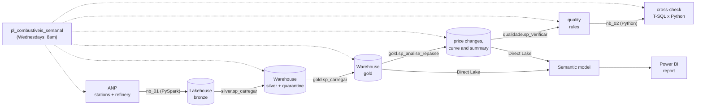

# Why did fuel get more expensive? · Microsoft Fabric + Power BI

[Versão em português](README.md)

The price of gasoline and diesel at the pump is the sum of three parts: **refinery**, **taxes** and **ethanol/biodiesel, freight and margins**. This project shows, for Brazil and for each state, how much a liter costs today, how much it changed and which of these parts explains the change.

A Microsoft Fabric pipeline fetches public data from ANP, Brazil's oil and fuel regulator, every week (the price at each surveyed gas station, the weekly survey by state and the price of producers and importers), processes it in layers (lakehouse → warehouse), splits the price of a liter using the method of ANP's Weekly Summary (Síntese Semanal) and delivers a Power BI report.


## What the data shows

Week of Oct 19, 2026, Brazil average, compared with the same week of 2025:

| | Regular gasoline | S10 diesel |
|---|---|---|
| Pump price | R$ 6.21 → **R$ 6.49** (+R$ 0.28) | R$ 6.11 → **R$ 7.30** (+R$ 1.19) |
| Refinery | +R$ 0.28 | +R$ 0.38 |
| Taxes | −R$ 0.52 | −R$ 0.25 |
| Ethanol/biodiesel, freight and margins | +R$ 0.52 | +R$ 1.06 |

- **The government cut taxes, and the price still went up.** Federal taxes on gasoline were reduced in September and zeroed in October 2026; a liter carried R$ 0.52 less in taxes, and the pump price still rose R$ 0.28.
- **Most of the increase happens after the refinery.** For diesel, R$ 1.06 of the R$ 1.19 increase is in biodiesel, freight and margins. For gasoline, that part rose R$ 0.52, as much as the tax cut.
- **The September tax cut did not reach the pump.** After Sep 10, gasoline stayed between R$ 6.56 and R$ 6.57 for three weeks.
- **Regional differences:** gasoline costs R$ 6.91 in the North and R$ 6.34 in the South.

What each indicator computes, the check against ANP and the taxes considered are in [docs/indicadores.md](docs/indicadores.md) (in Portuguese).

## Sources

| Source | What it has | How it is loaded |
|---|---|---|
| [Historical fuel price series](https://www.gov.br/anp/pt-br/centrais-de-conteudo/dados-abertos/serie-historica-de-precos-de-combustiveis) (ANP) | Selling price at each surveyed station, by product and collection date | Zipped half-year files since 2023 and, for the current half-year, the monthly files. Only new or resized files are downloaded again |
| [Weekly weighted average prices of producers and importers](https://www.gov.br/anp/pt-br/assuntos/precos-e-defesa-da-concorrencia/precos/ppidp/precos-medios-ponderados-semanais-2013.xls) (ANP) | Weekly average price, without ICMS, of gasoline A and S10 diesel A, by region | One .xls spreadsheet, fully reloaded |
| Weekly price survey by state (ANP) | Average retail price of each state and product, every week | One .xlsx spreadsheet; covers the weeks the station-level series has not published yet (it comes out monthly, with a lag) |
| Decrees and agreements (`config.tributo` table) | ICMS and federal taxes per liter, including the 2026 cuts | Configuration versioned in the repository |

The gasoline sold at the pump is gasoline A blended with anhydrous ethanol (27% until Jul 2025, 30% from Aug 2025 to Jul 2026 and 32% since Aug 2026), and S10 diesel is diesel A blended with biodiesel (B10 to B15). The blend in force each week lives in a configuration table and defines the fossil share of the liter.

## Architecture



- **Bronze (`nb_01_ingestao`)**: reads the ANP page, discovers the files (monthly file names changed over time) and stores each one as it came, with source file and load time. A control table keeps each file's size and hash; the two most recent are always reprocessed because ANP still corrects them.
- **Silver (T-SQL)**: types dates and values, keeps only liquid fuels sold by the liter and deduplicates (the same station, product and day can come in two files). Invalid records do not disappear: they go to a quarantine table with the reason (`data_invalida`, `valor_fora_da_faixa`, `unidade_inesperada`…).
- **Gold (T-SQL)**: average, median and range per week, city and state; refinery price with each week's fossil share; the split of the price of a liter into refinery, taxes and the rest, by state and for Brazil; weekly calendar.
- **Analysis (T-SQL)**: event study of the refinery-to-pump pass-through in RS (below).
- **Model and report**: the semantic model (TMDL, Direct Lake over the Warehouse) and the report (PBIR) are generated by code in `tools/` and published by the installer. The page background (frames) is drawn in HTML and rendered with Playwright.
- **Orchestration**: a Data Factory pipeline runs everything every Wednesday at 8am. ANP updates the refinery spreadsheet with about a 12-day lag.

## How the price is split

Same method as [ANP's Weekly Summary](https://www.gov.br/anp/pt-br/assuntos/precos-e-defesa-da-concorrencia/precos/sintese-semanal-do-comportamento-dos-precos-dos-combustiveis): pump price = refinery (fossil share, without taxes) + federal taxes + ICMS + the rest (anhydrous ethanol or biodiesel, freight and margins), with each week's pump price compared with the previous week's refinery price.

The difference from the Summary is that **federal taxes are the ones actually charged**, computed day by day. The Summary always uses the full statutory rate, so during the 2026 cuts the cut shows up as a drop in the refinery price. The data proves it: when federal taxes on gasoline were zeroed (Oct 10, 2026), the producers and importers price fell R$ 0.28, almost the tax removed (R$ 0.26); and after Sep 10 the Summary shows gasoline A at R$ 2.56, while Petrobras was selling it at R$ 3.05 before taxes. Outside the cut periods, the numbers match the Summary (table in [docs/indicadores.md](docs/indicadores.md)).

## Complementary analysis: refinery-to-pump pass-through in RS

The warehouse also measures, price change by price change, how much of a refinery change reaches gas stations in Rio Grande do Sul. Since January 2023 there were 31 refinery price changes in the South region: for gasoline, increases reached the pump in full within a week, while for cuts less than 40% got there in two weeks.

### How pass-through is measured

1. **Refinery series**: average price of producers and importers in the South region, **smoothed with a 3-week median**. The spreadsheet mixes refineries and importers, and the mix changes from week to week; without smoothing, a one-week spike (gasoline: 3.50 → 4.53 → 3.50 in August 2026) became a false −23% price change.
2. **Price change**: a week in which the smoothed series moves 2% or more. Consecutive weeks in the same direction count as one change (the 2026 diesel increase came over three weeks).
3. **Expected pass-through** = refinery change × fossil share of the liter. ICMS became a fixed amount per liter in 2023 (diesel in May, gasoline in June), so from then on it no longer amplifies the pass-through.
4. **Observed pass-through** after h weeks = average pump price in RS at t+h minus the one in the week before the change.
5. Each change is followed for up to 8 weeks, **but only until the next change**, so one does not contaminate the measurement of the other.

The same analysis runs for each RS city with at least 5 surveyed stations in the week.

## Quality and cross-check

- **Quality rules** (`fabric/sql/05_qualidade.sql`), stored on every run in `qualidade.resultado`: row reconciliation between bronze, silver and quarantine; duplicate keys in silver and gold; refinery weeks without a configured blend in the analyzed period; RS average out of range; missing weeks; stale sources; one-week spikes at the refinery. A rule with `erro` severity stops the pipeline.
- **Independent cross-check** (`nb_02_conferencia`): recomputes in Python, straight from bronze, the weekly RS average, the list of price changes and the pass-through curve, and compares with what the Warehouse produced in T-SQL. If they do not match, the pipeline fails. Before checking, it refreshes the semantic model so that new gold tables show up in Direct Lake.
- **Tests** (`tests/`): reading ANP files (BOM, latin-1, zip, missing columns), discovering files on the page in both name formats, and converting the refinery spreadsheet and the weekly survey by state.

## Report

One page, dark theme, no explanatory text: five cards (pump price, change over 4 weeks and 12 months, taxes per liter and ethanol ÷ gasoline, which becomes the refinery change when diesel is selected), the weekly price breakdown, what changed in each part over 12 months and the price by region. Filters for fuel (regular gasoline or S10 diesel) and state.

## How to run

Locally (tests):

```bash
pip install pandas pytest
pytest
```

In Fabric:

1. Create a workspace with capacity (the trial one works).
2. Create a notebook and run it, pinning the commit you reviewed:
   ```python
   import requests
   COMMIT = "<full-commit-sha>"
   EXECUTAR = True
   exec(requests.get(f"https://raw.githubusercontent.com/GuilhermeRostirolla/precos-combustiveis-fabric/{COMMIT}/tools/instalar_no_fabric.py").text)
   ```
   The installer creates the lakehouse, the warehouse, the notebooks, the SQL objects, the pipeline with its weekly schedule, the semantic model and the report. With `EXECUTAR = True`, it triggers the first load (about 10 minutes).

## Problems along the way

- **Spikes in the refinery spreadsheet.** The producers and importers average swings from week to week when an importer enters or leaves. The first version of the analysis found 65 "price changes", many of them one-week spikes; with the 3-week median and grouping consecutive weeks, 31 remained.
- **"Isolated" changes only.** The first rule only accepted changes with no other change in the following 6 weeks. With frequent changes, that discarded almost all diesel. Following each change until the next one uses all of them without mixing effects.
- **Blend configured for only part of the history.** The refinery spreadsheet starts in 2013, but the blend table started in 2015 (gasoline) and 2018 (diesel); the quality rule flagged 2,201 weeks without a blend. Since the analysis starts in 2023, the rule now requires a blend only in the analyzed period.
- **Spark session limit on the trial capacity (error 430).** The installer triggers the pipeline and ends its own session; ingestion retries after 2 minutes.
- **Temporary tables in the Fabric Warehouse.** Only a temp table created with `SELECT ... INTO` can be combined with warehouse tables in the same query, so the quality rules live in a single `SELECT INTO`.
- **Lagging SQL endpoint.** Right after ingestion, the lakehouse endpoint does not see the new tables yet; the notebook requests a metadata refresh before the Warehouse reads bronze.
- **SQL decimals in Python.** `pyodbc` returns `decimal.Decimal`, which does not mix with `float` in the cross-check math.
- **Tax cuts in the middle of the week.** The 2026 cuts started on a Thursday (Sep 10) and on a Saturday (Oct 10). Using the whole week's tax, one week showed R$ 0.40 of extra margin; the tax is now the average of the days.
- **The refinery spreadsheet carries the tax actually charged, not the full rate.** The first version subtracted the full rate, and the September cut showed up as a refinery drop. The R$ 0.28 drop when taxes were zeroed in October proved otherwise.
- **Data a month behind.** The station-level series comes out monthly; the weekly survey by state fills in the most recent weeks. The last week of each month in the series is incomplete and is replaced by the weekly survey.
- **Stale table stuck in the model.** A table removed from gold remained as a file in the generated model and made the refresh fail; the generator now deletes files of tables that are gone.

## Limitations

- ANP only publishes the refinery price by region: a state uses its region's price (the page shows which one).
- ANP's survey is a sample (about 4,500 gasoline stations per week in Brazil, fewer than 50 in some states); changes of a few cents may be just sampling differences.
- "Ethanol/biodiesel, freight and margins" is what is left over: there is no weekly public source that splits each item.
- The producers and importers price mixes refineries and importers; the 2026 subsidies show up as a lower refinery price.
- In the pass-through study, changes in anhydrous ethanol, biodiesel, freight, margins and ICMS also move the final price and are not separated.

## Structure

```
src/anp.py                  reading the ANP sources (no Spark, testable locally)
fabric/notebooks/           ingestion (bronze) and cross-check
fabric/sql/                 config, silver, gold, pass-through analysis and quality (T-SQL)
fabric/*.SemanticModel/     semantic model (TMDL), generated by tools/gerar_modelo.py
fabric/*.Report/            report (PBIR), generated by tools/gerar_relatorio.py
tools/instalar_no_fabric.py installation and update in the workspace
docs/indicadores.md         what each indicator computes and the check against ANP
tests/
```

## License

[MIT](LICENSE)
