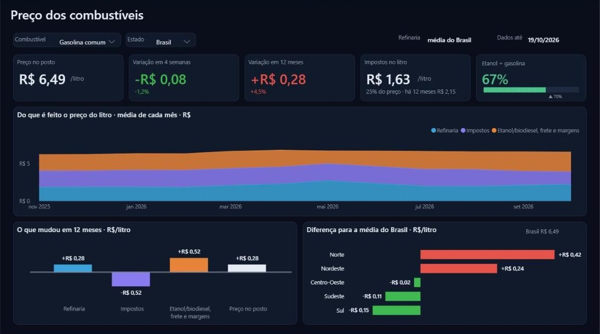
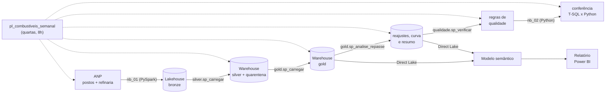

# Por que o combustível ficou mais caro? · Microsoft Fabric + Power BI

[English version](README.en.md)

O preço da gasolina e do diesel no posto é a soma de três partes: **refinaria**, **impostos** e **etanol/biodiesel, frete e margens**. Este projeto mostra, para o Brasil e para cada estado, quanto custa o litro hoje, quanto mudou e qual dessas partes explica a mudança.

Um pipeline no Microsoft Fabric busca toda semana os dados públicos da ANP (preço de cada posto pesquisado, levantamento semanal por estado e preço de produtores e importadores), trata tudo em camadas (lakehouse → warehouse), divide o preço do litro pelo método da Síntese Semanal da ANP e entrega um relatório no Power BI.



## O que os dados mostram

Semana de 19/10/2026, média do Brasil, comparada com a mesma semana de 2025:

| | Gasolina comum | Diesel S10 |
|---|---|---|
| Preço no posto | R$ 6,21 → **R$ 6,49** (+R$ 0,28) | R$ 6,11 → **R$ 7,30** (+R$ 1,19) |
| Refinaria | +R$ 0,24 | +R$ 0,40 |
| Impostos | −R$ 0,52 | −R$ 0,25 |
| Etanol/biodiesel, frete e margens | +R$ 0,56 | +R$ 1,04 |

- **O governo cortou impostos, mas o preço subiu mesmo assim.** Na gasolina, os tributos federais foram reduzidos em setembro e zerados em outubro de 2026; o litro pagou R$ 0,52 a menos de imposto, e o preço no posto ainda subiu R$ 0,28.
- **A maior parte da alta está depois da refinaria.** No diesel, R$ 1,04 dos R$ 1,19 de aumento estão em biodiesel, frete e margens. Na gasolina, essa parte subiu R$ 0,56, mais que o corte de impostos.
- **O corte de setembro não chegou à bomba.** Depois de 10/09, a gasolina continuou entre R$ 6,56 e R$ 6,57 por três semanas.
- **Diferenças regionais:** a gasolina custa R$ 6,91 no Norte e R$ 6,34 no Sul.

O que cada indicador calcula, a conferência com a ANP e os impostos considerados estão em [docs/indicadores.md](docs/indicadores.md).

## Fontes

| Fonte | O que traz | Como entra |
|---|---|---|
| [Série histórica de preços de combustíveis](https://www.gov.br/anp/pt-br/centrais-de-conteudo/dados-abertos/serie-historica-de-precos-de-combustiveis) (ANP) | Preço de venda de cada posto pesquisado, por produto e data da coleta | Arquivos semestrais compactados desde 2023 e, para o semestre corrente, os mensais. Só baixa de novo o que é novo ou mudou de tamanho |
| [Preços médios ponderados semanais de produtores e importadores](https://www.gov.br/anp/pt-br/assuntos/precos-e-defesa-da-concorrencia/precos/ppidp/precos-medios-ponderados-semanais-2013.xls) (ANP) | Preço médio semanal, sem ICMS, de gasolina A e diesel S10 A, por região | Uma planilha .xls, recarregada inteira |
| Levantamento semanal de preços por estado (ANP) | Preço médio de revenda de cada estado e produto, toda semana | Uma planilha .xlsx; cobre as semanas que a série posto a posto ainda não trouxe (ela sai por mês, com atraso) |
| Decretos e convênios (tabela `config.tributo`) | ICMS e tributos federais por litro, inclusive os cortes de 2026 | Configuração versionada no repositório |

A gasolina vendida no posto é a gasolina A com etanol anidro (27% até jul/2025, 30% de ago/2025 a jul/2026 e 32% desde ago/2026), e o diesel S10 é o diesel A com biodiesel (B10 a B15). A mistura vigente em cada semana fica numa tabela de configuração e define a parcela fóssil do litro.

## Arquitetura



- **Bronze (`nb_01_ingestao`)**: lê a página da ANP, descobre os arquivos (o nome dos arquivos mensais mudou ao longo do tempo) e grava cada um como veio, com o arquivo de origem e a hora da carga. Uma tabela de controle guarda tamanho e hash de cada arquivo; os dois mais recentes são sempre reprocessados porque a ANP ainda os corrige.
- **Silver (T-SQL)**: tipa datas e valores, fica só com combustível líquido vendido por litro e deduplica (o mesmo posto, produto e dia pode vir em dois arquivos). Registro inválido não some: vai para a quarentena com o motivo (`data_invalida`, `valor_fora_da_faixa`, `unidade_inesperada`…).
- **Gold (T-SQL)**: preço médio, mediano e faixa por semana, município e estado; preço da refinaria com a parcela fóssil de cada semana; a divisão do preço do litro em refinaria, impostos e o restante, por estado e para o Brasil; calendário semanal.
- **Análise (T-SQL)**: estudo de eventos do repasse da refinaria à bomba no RS (abaixo).
- **Modelo e relatório**: o modelo semântico (TMDL, Direct Lake sobre o Warehouse) e o relatório (PBIR) são gerados por código em `tools/` e publicados pelo instalador. A imagem de fundo da página (molduras) é desenhada em HTML e gerada com Playwright.
- **Orquestração**: um pipeline do Data Factory roda tudo toda quarta às 8h. A ANP atualiza a planilha de refinaria com cerca de 12 dias de atraso.

## Como o preço é dividido

Mesmo método da [Síntese Semanal da ANP](https://www.gov.br/anp/pt-br/assuntos/precos-e-defesa-da-concorrencia/precos/sintese-semanal-do-comportamento-dos-precos-dos-combustiveis): preço no posto = refinaria (parcela fóssil, sem tributos) + tributos federais + ICMS + o restante (etanol anidro ou biodiesel, frete e margens), com o posto da semana comparado com a refinaria da semana anterior.

A diferença em relação à Síntese é que os **tributos federais são os efetivamente cobrados**, calculados dia a dia. A Síntese usa sempre a alíquota cheia, então, durante os cortes de 2026, o corte aparece como queda do preço da refinaria. A prova está nos dados: quando os tributos da gasolina foram zerados (10/10/2026), o preço de produtores e importadores caiu R$ 0,28, quase o imposto que saiu (R$ 0,26); e, depois de 10/09, a Síntese mostra a gasolina A a R$ 2,56, enquanto a Petrobras a vendia a R$ 3,05 sem tributos. Fora dos períodos de corte, os números batem com a Síntese (tabela em [docs/indicadores.md](docs/indicadores.md)).

O Brasil é a média dos estados, ponderada pelas coletas, e cada estado usa a refinaria da sua região. A série "Brasil" da planilha de produtores pesa pelo volume vendido e dispara quando o Nordeste importa caro (maio/2026: R$ 5,26 contra R$ 3,47 a R$ 3,64 no Sul, Sudeste e Centro-Oeste), enquanto a média dos postos é dominada pelo Sul e pelo Sudeste.

## Análise complementar: repasse da refinaria à bomba no RS

O warehouse também mede, reajuste a reajuste, quanto da mudança na refinaria chega aos postos do Rio Grande do Sul. Desde janeiro de 2023 foram 31 reajustes na refinaria da região Sul: na gasolina, as altas chegaram inteiras ao posto em uma semana, e nas baixas menos de 40% chegou em duas semanas.

### Como o repasse é medido

1. **Série da refinaria**: preço médio de produtores e importadores da região Sul, **suavizado pela mediana de 3 semanas**. A planilha mistura refinarias e importadores, e a proporção muda de uma semana para outra; sem a suavização, um pico de uma semana (gasolina: 3,50 → 4,53 → 3,50 em agosto/2026) virava um falso reajuste de −23%.
2. **Reajuste**: semana em que a série suavizada varia 2% ou mais. Semanas seguidas no mesmo sentido contam como um reajuste só (a alta do diesel em 2026 veio ao longo de três semanas).
3. **Repasse esperado** = variação na refinaria × parcela fóssil do litro. O ICMS virou um valor fixo por litro em 2023 (diesel em maio, gasolina em junho), então a partir daí não amplia o repasse.
4. **Repasse observado** em h semanas = preço médio dos postos do RS em t+h menos o da semana anterior ao reajuste.
5. Cada reajuste é acompanhado por até 8 semanas, **mas só até o reajuste seguinte**, para um não contaminar a medição do outro.

A mesma análise roda para cada município do RS com pelo menos 5 postos pesquisados na semana.

## Qualidade e conferência

- **Regras de qualidade** (`fabric/sql/05_qualidade.sql`), gravadas a cada execução em `qualidade.resultado`: reconciliação de linhas entre bronze, silver e quarentena; chaves duplicadas na silver e na gold; refinaria sem mistura configurada no período analisado; média do RS fora de faixa; semanas faltando; fontes desatualizadas; picos de uma semana na refinaria. Regra com severidade `erro` interrompe o pipeline.
- **Conferência independente** (`nb_02_conferencia`): recalcula em Python, direto da bronze, o preço médio semanal do RS, a lista de reajustes e a curva de repasse, e compara com o que o Warehouse produziu em T-SQL. Se não bater, o pipeline falha. Antes de conferir, atualiza o modelo semântico, para que tabelas novas da gold apareçam no Direct Lake.
- **Testes** (`tests/`): leitura dos arquivos da ANP (BOM, latin-1, zip, colunas faltando), descoberta dos arquivos na página nos dois formatos de nome, conversão da planilha de refinaria e do levantamento semanal por estado.

## Relatório

Uma página, em tema escuro, sem textos de apoio: cinco cartões (preço no posto, variação em 4 semanas e em 12 meses, impostos no litro e etanol ÷ gasolina, que vira a variação da refinaria quando o diesel é escolhido), as três partes do preço mês a mês, em linhas separadas, o que mudou em cada parte em 12 meses (com o resultado no posto) e a diferença de cada região para a média do Brasil, com o estado escolhido em destaque. Filtros de combustível (gasolina comum ou diesel S10) e de estado.

## Como rodar

Local (testes):

```bash
pip install pandas pytest
pytest
```

No Fabric:

1. Crie um workspace com capacidade (a de avaliação serve).
2. Crie um notebook e rode, fixando o commit que você revisou:
   ```python
   import requests
   COMMIT = "<sha-completo-do-commit>"
   EXECUTAR = True
   exec(requests.get(f"https://raw.githubusercontent.com/GuilhermeRostirolla/precos-combustiveis-fabric/{COMMIT}/tools/instalar_no_fabric.py").text)
   ```
   O instalador cria o lakehouse, o warehouse, os notebooks, os objetos SQL, o pipeline com a agenda semanal, o modelo semântico e o relatório. Com `EXECUTAR = True`, dispara a primeira carga (cerca de 10 minutos).

## Problemas que apareceram no caminho

- **Picos na planilha de refinaria.** A média de produtores e importadores oscila de uma semana para outra quando entra ou sai um importador. A primeira versão da análise encontrava 65 "reajustes", muitos deles picos de uma semana; com a mediana de 3 semanas e o agrupamento de semanas seguidas, ficaram 31.
- **Reajustes "isolados" demais.** A primeira regra só aceitava reajustes sem outro nas 6 semanas seguintes. Com reajustes frequentes, isso descartava quase todo o diesel. Acompanhar cada um até o seguinte aproveita todos sem misturar efeitos.
- **Mistura configurada só em parte do histórico.** A planilha de refinaria começa em 2013, mas a tabela de mistura começava em 2015 (gasolina) e 2018 (diesel); a regra de qualidade acusava 2.201 semanas sem mistura. Como a análise começa em 2023, a regra passou a exigir mistura só no período analisado.
- **Limite de sessões Spark na capacidade de avaliação (erro 430).** O instalador dispara o pipeline e encerra a própria sessão; a ingestão tem uma nova tentativa depois de 2 minutos.
- **Tabelas temporárias no Warehouse do Fabric.** Só uma temporária criada com `SELECT ... INTO` pode ser combinada com tabelas do warehouse na mesma consulta; por isso as regras de qualidade ficam num único `SELECT INTO`.
- **SQL endpoint atrasado.** Logo depois da ingestão, o endpoint do lakehouse ainda não enxerga as tabelas novas; o notebook pede a atualização dos metadados antes de o Warehouse ler a bronze.
- **Decimal do SQL no Python.** O `pyodbc` devolve `decimal.Decimal`, que não se mistura com `float` nas contas da conferência.
- **Cortes de imposto no meio da semana.** Os cortes de 2026 começaram numa quinta (10/09) e num sábado (10/10). Com o imposto da semana inteira, uma semana aparecia com R$ 0,40 a mais de margem; o tributo passou a ser a média dos dias.
- **A planilha da refinaria traz o imposto cobrado, não o cheio.** A primeira versão descontava a alíquota cheia, e o corte de setembro aparecia como queda da refinaria. A queda de R$ 0,28 quando os tributos foram zerados em outubro mostrou o contrário.
- **Dados com um mês de atraso.** A série posto a posto sai por mês; o levantamento semanal por estado completa as semanas mais recentes. A última semana de cada mês da série vem incompleta e é substituída pelo levantamento semanal.
- **Tabela antiga presa no modelo.** Uma tabela removida da gold continuava como arquivo no modelo gerado e fazia a atualização falhar; o gerador agora apaga arquivos de tabelas que saíram.

## Limitações

- A ANP só publica o preço de refinaria por região: um estado usa o da região dele (a página mostra qual).
- A pesquisa da ANP é amostral (cerca de 4.500 postos de gasolina por semana no Brasil, menos de 50 em alguns estados); variações de poucos centavos podem ser só diferença de amostra.
- "Etanol/biodiesel, frete e margens" é o que sobra da conta: não há fonte pública semanal que separe cada item.
- O preço de produtores e importadores mistura refinarias e importadores; as subvenções de 2026 aparecem como preço menor da refinaria.
- No estudo de repasse, mudanças no etanol anidro, no biodiesel, no frete, nas margens e no ICMS também mexem no preço final e não são separadas.

## Estrutura

```
src/anp.py                  leitura das fontes da ANP (sem Spark, testável localmente)
fabric/notebooks/           ingestão (bronze) e conferência
fabric/sql/                 config, silver, gold, análise do repasse e qualidade (T-SQL)
fabric/*.SemanticModel/     modelo semântico (TMDL), gerado por tools/gerar_modelo.py
fabric/*.Report/            relatório (PBIR), gerado por tools/gerar_relatorio.py
tools/instalar_no_fabric.py instalação e atualização no workspace
docs/indicadores.md         o que cada indicador calcula e a conferência com a ANP
tests/
```

## Licença

[MIT](LICENSE)
