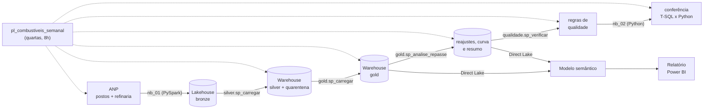

# Da refinaria à bomba no RS · Microsoft Fabric + Power BI

[English version](README.en.md)

Quando o preço da gasolina ou do diesel muda na refinaria, **quanto disso chega ao posto no Rio Grande do Sul, e em quanto tempo?** E chega igual quando sobe e quando cai?

Este projeto responde com dados públicos da ANP: um pipeline no Microsoft Fabric busca toda semana o preço de cada posto pesquisado no Brasil e o preço médio de produtores e importadores, trata tudo em camadas (lakehouse → warehouse), mede o repasse de cada reajuste e entrega um relatório no Power BI.


## O que os dados mostram

Desde janeiro de 2023, a série da refinaria (região Sul) teve **31 reajustes**: 12 na gasolina e 19 no diesel S10. Para cada um, comparei a variação no preço médio dos postos do RS com o que a refinaria explicaria (variação × parcela fóssil do litro).

| Quanto do reajuste chegou à bomba (RS) | na semana | em 1 semana | em 2 semanas |
|---|---|---|---|
| Gasolina, **alta** na refinaria (6 reajustes) | 69% | 125% | 150% |
| Gasolina, **baixa** na refinaria (6 reajustes) | 15% | 35% | 39% |
| Diesel S10, **alta** na refinaria (8 reajustes) | 18% | 53% | 89% |
| Diesel S10, **baixa** na refinaria (11 reajustes) | 10% | 28% | 44% |

*Repasse ponderado: soma das variações na bomba ÷ soma do que a refinaria explicaria, então cada reajuste pesa pelo seu tamanho. Acima de 100% = a bomba subiu mais do que o custo do derivado fóssil explica.*

- **Sobe de foguete, desce de pena.** Na gasolina, as altas chegam inteiras ao posto em uma semana; nas baixas, menos de 40% chegou em duas semanas. No diesel a assimetria é menor, mas existe.
- **O choque do diesel em 2026** é o caso mais claro. Em março a refinaria subiu 50% em três semanas (de R$ 3,64 para R$ 5,45 por litro, média de produtores e importadores do Sul) e o diesel S10 no RS foi de R$ 6,19 para R$ 7,51: 86% do esperado em três semanas. Em abril a refinaria voltou para R$ 3,77; três semanas depois, só 27% da queda tinha chegado à bomba. Em agosto, com a refinaria de volta ao nível de fevereiro, o diesel no RS ainda custava R$ 6,59, R$ 0,40 acima de antes do choque.

São poucos reajustes por grupo (6 a 11), então os números indicam um padrão, não uma lei. E o preço na bomba tem outros componentes que também mudam (etanol anidro e biodiesel, frete, margens e ICMS); a análise mede o quanto a bomba se moveu em relação ao que a refinaria explicaria, não prova a causa da diferença.

## Fontes

| Fonte | O que traz | Como entra |
|---|---|---|
| [Série histórica de preços de combustíveis](https://www.gov.br/anp/pt-br/centrais-de-conteudo/dados-abertos/serie-historica-de-precos-de-combustiveis) (ANP) | Preço de venda de cada posto pesquisado, por produto e data da coleta | Arquivos semestrais compactados desde 2023 e, para o semestre corrente, os mensais. Só baixa de novo o que é novo ou mudou de tamanho |
| [Preços médios ponderados semanais de produtores e importadores](https://www.gov.br/anp/pt-br/assuntos/precos-e-defesa-da-concorrencia/precos/ppidp/precos-medios-ponderados-semanais-2013.xls) (ANP) | Preço médio semanal, sem ICMS, de gasolina A e diesel S10 A, por região | Uma planilha .xls, recarregada inteira |

A gasolina vendida no posto é a gasolina A com etanol anidro (27% até jul/2025, 30% depois), e o diesel S10 é o diesel A com biodiesel (B10 a B15). A mistura vigente em cada semana fica numa tabela de configuração e define a parcela fóssil do litro.

## Arquitetura



- **Bronze (`nb_01_ingestao`)**: lê a página da ANP, descobre os arquivos (o nome dos arquivos mensais mudou ao longo do tempo) e grava cada um como veio, com o arquivo de origem e a hora da carga. Uma tabela de controle guarda tamanho e hash de cada arquivo; os dois mais recentes são sempre reprocessados porque a ANP ainda os corrige.
- **Silver (T-SQL)**: tipa datas e valores, fica só com combustível líquido vendido por litro e deduplica (o mesmo posto, produto e dia pode vir em dois arquivos). Registro inválido não some: vai para a quarentena com o motivo (`data_invalida`, `valor_fora_da_faixa`, `unidade_inesperada`…).
- **Gold (T-SQL)**: preço médio, mediano e faixa por semana, município e estado; preço da refinaria com a parcela fóssil de cada semana; calendário semanal.
- **Análise (T-SQL)**: estudo de eventos do repasse (abaixo).
- **Modelo e relatório**: o modelo semântico (TMDL, Direct Lake sobre o Warehouse) e o relatório (PBIR, 3 páginas) são gerados por código em `tools/` e publicados pelo instalador.
- **Orquestração**: um pipeline do Data Factory roda tudo toda quarta às 8h. A ANP atualiza a planilha de refinaria com cerca de 12 dias de atraso.

## Como o repasse é medido

1. **Série da refinaria**: preço médio de produtores e importadores da região Sul, **suavizado pela mediana de 3 semanas**. A planilha mistura refinarias e importadores, e a proporção muda de uma semana para outra; sem a suavização, um pico de uma semana (gasolina: 3,50 → 4,53 → 3,50 em agosto/2026) virava um falso reajuste de −23%.
2. **Reajuste**: semana em que a série suavizada varia 2% ou mais. Semanas seguidas no mesmo sentido contam como um reajuste só (a alta do diesel em 2026 veio ao longo de três semanas).
3. **Repasse esperado** = variação na refinaria × parcela fóssil do litro. O ICMS virou um valor fixo por litro em 2023 (diesel em maio, gasolina em junho), então a partir daí não amplia o repasse.
4. **Repasse observado** em h semanas = preço médio dos postos do RS em t+h menos o da semana anterior ao reajuste.
5. Cada reajuste é acompanhado por até 8 semanas, **mas só até o reajuste seguinte**, para um não contaminar a medição do outro.

A mesma análise roda para cada município do RS com pelo menos 5 postos pesquisados na semana.

## Qualidade e conferência

- **Regras de qualidade** (`fabric/sql/05_qualidade.sql`), gravadas a cada execução em `qualidade.resultado`: reconciliação de linhas entre bronze, silver e quarentena; chaves duplicadas na silver e na gold; refinaria sem mistura configurada no período analisado; média do RS fora de faixa; semanas faltando; fontes desatualizadas; picos de uma semana na refinaria. Regra com severidade `erro` interrompe o pipeline.
- **Conferência independente** (`nb_02_conferencia`): recalcula em Python, direto da bronze, o preço médio semanal do RS, a lista de reajustes e a curva de repasse, e compara com o que o Warehouse produziu em T-SQL. Se não bater, o pipeline falha. Foi essa conferência que confirmou que a regra nova de reajustes dá o mesmo resultado nas duas linguagens.
- **Testes** (`tests/`): leitura dos arquivos da ANP (BOM, latin-1, zip, colunas faltando), descoberta dos arquivos na página nos dois formatos de nome e conversão da planilha de refinaria.

## Relatório

| Bomba x refinaria | Municípios |
|---|---|
|  |  |

## Como rodar

Local (testes):

```bash
pip install pandas pytest
pytest
```

No Fabric:

1. Crie um workspace com capacidade (a de avaliação serve).
2. Crie um notebook e rode, fixando o commit que você revisou:
   ```python
   import requests
   COMMIT = "<sha-completo-do-commit>"
   EXECUTAR = True
   exec(requests.get(f"https://raw.githubusercontent.com/GuilhermeRostirolla/precos-combustiveis-fabric/{COMMIT}/tools/instalar_no_fabric.py").text)
   ```
   O instalador cria o lakehouse, o warehouse, os notebooks, os objetos SQL, o pipeline com a agenda semanal, o modelo semântico e o relatório. Com `EXECUTAR = True`, dispara a primeira carga (cerca de 10 minutos).

## Problemas que apareceram no caminho

- **Picos na planilha de refinaria.** A média de produtores e importadores oscila de uma semana para outra quando entra ou sai um importador. A primeira versão da análise encontrava 65 "reajustes", muitos deles picos de uma semana; com a mediana de 3 semanas e o agrupamento de semanas seguidas, ficaram 31.
- **Reajustes "isolados" demais.** A primeira regra só aceitava reajustes sem outro nas 6 semanas seguintes. Com reajustes frequentes, isso descartava quase todo o diesel. Acompanhar cada um até o seguinte aproveita todos sem misturar efeitos.
- **Mistura configurada só em parte do histórico.** A planilha de refinaria começa em 2013, mas a tabela de mistura começava em 2015 (gasolina) e 2018 (diesel); a regra de qualidade acusava 2.201 semanas sem mistura. Como a análise começa em 2023, a regra passou a exigir mistura só no período analisado.
- **Limite de sessões Spark na capacidade de avaliação (erro 430).** O instalador dispara o pipeline e encerra a própria sessão; a ingestão tem uma nova tentativa depois de 2 minutos.
- **Tabelas temporárias no Warehouse do Fabric.** Só uma temporária criada com `SELECT ... INTO` pode ser combinada com tabelas do warehouse na mesma consulta; por isso as regras de qualidade ficam num único `SELECT INTO`.
- **SQL endpoint atrasado.** Logo depois da ingestão, o endpoint do lakehouse ainda não enxerga as tabelas novas; o notebook pede a atualização dos metadados antes de o Warehouse ler a bronze.
- **Decimal do SQL no Python.** O `pyodbc` devolve `decimal.Decimal`, que não se mistura com `float` nas contas da conferência.

## Limitações

- O preço de produtores e importadores da região Sul é uma aproximação do que as distribuidoras do RS pagam; ele mistura refinarias e importadores.
- A pesquisa da ANP é amostral: em média 300 postos de gasolina por semana no RS, menos nos municípios pequenos.
- O repasse compara a bomba com a parcela fóssil; mudanças no preço do etanol anidro, do biodiesel, do frete, das margens e do ICMS também mexem no preço final e não são separadas aqui. Nos reajustes do primeiro semestre de 2023 o ICMS ainda era uma alíquota, o que aumenta um pouco o repasse esperado.

## Estrutura

```
src/anp.py                  leitura das fontes da ANP (sem Spark, testável localmente)
fabric/notebooks/           ingestão (bronze) e conferência
fabric/sql/                 config, silver, gold, análise do repasse e qualidade (T-SQL)
fabric/*.SemanticModel/     modelo semântico (TMDL), gerado por tools/gerar_modelo.py
fabric/*.Report/            relatório (PBIR), gerado por tools/gerar_relatorio.py
tools/instalar_no_fabric.py instalação e atualização no workspace
tests/
```

## Licença

[MIT](LICENSE)
